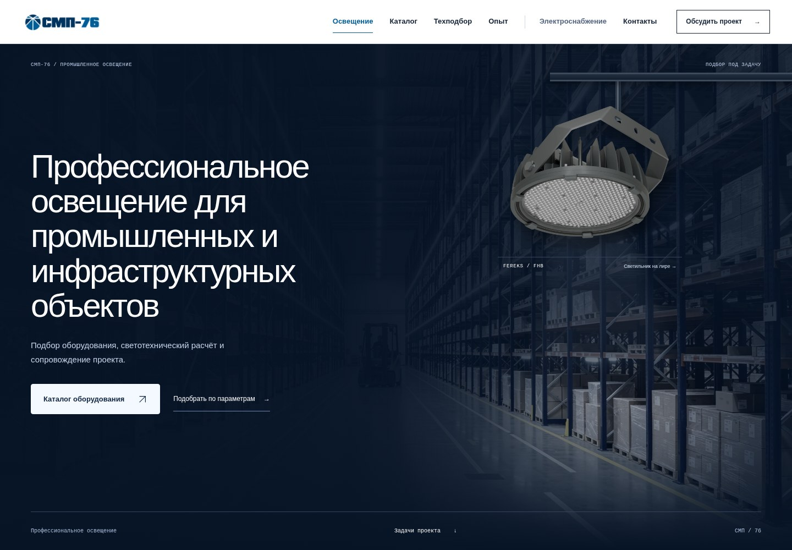

# SMP — свет строит пространство

Ветка: `redesign-preview-v2`. Основа: `95d0b7d`. Публичные страницы и маршруты сохранены.

Hero уточнён по запросу владельца: вместо абстрактной архитектуры используется реальный FEREKS FHB в складском интерьере. Остальные секции не менялись. [Описание изменения hero](HERO-FHB.md).

Согласованная композиция объединяет пространственный язык направления №1, инженерные инструменты направления №2 и редакционную подачу опыта направления №3. Это презентационный слой существующего статического сайта, без новых зависимостей приложения, внешних шрифтов, аналитики, форм заявок или backend.

Перед входом в технический подбор добавлен [образовательный блок CRI и цветовой температуры](COLOUR-LAB.md) на иллюстрации контроля окраски. [Точка входа для согласования](../review/START-HERE.html) объединяет автономные демонстрации, снимки и запуск полного сайта.

## Снимки для визуальной проверки

Для проверки hero в действии используйте [автономный интерактивный HTML и инструкцию скачивания](HERO-FHB.md#интерактивная-проверка-без-сервера). JPG не содержит анимацию.

Снимки сделаны в Chromium при масштабе 100%, без изменения содержимого страницы для съёмки. Ссылки ведут на файлы этой ветки. Для главной доступны полные страницы; для остальных — первые экраны рабочих интерфейсов. Series показана на существующей серии LEDEL L-lego II (`series.html?series=ledel-l-lego-ii`). Движение и интерактивные состояния следует проверять в браузере.

| Страница | Desktop 1440 px | Mobile 390 px |
| --- | --- | --- |
| Главная, первый экран | [Открыть](preview-v2/home-1440.jpg) | [Открыть](preview-v2/home-390.jpg) |
| Главная, полностью | [Открыть](preview-v2/home-1440-full.jpg) | [Открыть](preview-v2/home-390-full.jpg) |
| Каталог | [Открыть](preview-v2/catalog-1440.jpg) | [Открыть](preview-v2/catalog-390.jpg) |
| Технический подбор | [Открыть](preview-v2/selection-1440.jpg) | [Открыть](preview-v2/selection-390.jpg) |
| Series | [Открыть](preview-v2/series-1440.jpg) | [Открыть](preview-v2/series-390.jpg) |
| Электроснабжение | [Открыть](preview-v2/elektrosnabzhenie-1440.jpg) | [Открыть](preview-v2/elektrosnabzhenie-390.jpg) |



## Структура главной, показанная до реализации

```text
01  Архитектурная hero-сцена / крупная типографика / каталог и подбор
02  Существующие показатели SMP
03  Шесть задач — вертикальная последовательность раскрывающихся сцен
04  Опыт — крупный разворот и два блока разного масштаба
05  Отрасли — большая световая среда и девять доступных переключателей
06  Производители — единый индекс брендов и сменяемая предметная фотосцена
07  Услуги и сопровождение — от требований к поставке
08  Инженерный подбор
09  Контакты и направление электроснабжения
```

## Свет и движение

Hero показывает исходную фотографию FEREKS FHB с видимой оптикой и лирой в затемнённом складском интерьере. Светильник связан с потолочной опорой и ограниченно наклоняется вокруг точки крепления. Курсор проявляет участок склада по всему hero, а луч связывает оптику с выбранным местом и движется с той же инерцией. Слабый общий свет сохраняет читаемость стеллажей и перспективы за пределами пятна. Новые ракурсы и геометрия продукта не генерируются. Демонстрация не является фотометрическим расчётом.

Время не управляет яркостью. Нет canvas/WebGL, повторяющихся световых рамок, мигающих линий или бесконечной idle-анимации. После завершения инерции обновления прекращаются; вне экрана и в скрытой вкладке они останавливаются. Контроллер и адаптер отображения фотографии разделены.

Типографика, фотография и ссылки существуют в HTML. На mobile, при reduced motion, экономии трафика и без JavaScript сохраняется статичная композиция. Сайт не перехватывает wheel/touch-прокрутку и не требует прохождения анимации перед доступом к содержимому.

| Действие | Характер движения |
| --- | --- |
| Кнопки и управляющие элементы | 160–240 мс |
| Раскрытие задачи | 500 мс; нативный details/summary |
| Фотография отрасли | Перекрёстный переход около 1100 мс после загрузки |
| Световая атмосфера отрасли | Плавное смещение 1400 мс |
| Предметное фото серии | Небольшой tilt, переход 1000 мс |
| Hero | Инерция после движения курсора; неподвижность без ввода; scroll без перехвата |

При reduced motion переходы отключаются, tilt не применяется, hero остаётся статичным.

## Industry explorer и опыт

Выбор отрасли сразу обновляет название, краткое описание, номер, количество и исходный список объектов. Фотография загружается до перехода; повторные быстрые выборы не могут подменить финальный выбор устаревшим ответом загрузки. Меняется положение мягкого светового слоя.

Все девять отраслей сохраняют исходные проекты. Доступны мышь, касание, Tab, стрелки, Home/End. Движение не является условием получения информации. Без JavaScript в HTML остаётся первая отрасль и её пять объектов.

Опыт оформлен крупным разворотом и парой изображений разного масштаба. Названия объектов взяты из существующего референс-листа. Фотографии подписаны как отраслевые иллюстрации: конкретному объекту не приписывается неподтверждённый снимок. Новые фотографии проектов, результаты расчётов и значения экономии не выдумывались.

## Производители

Пять производителей представлены единым индексом, а не пятью отдельными карточками. Hover и клавиатурный фокус меняют реальную фотографию серии и её подпись. Ссылки ведут в прежний каталог с существующим параметром `brand`. Количества: FEREKS 48, LEDEL 35, ARUNA 38, LUXCORE 12, PLG 41.

Для PLG сохраняется текстовый placeholder без выдуманного изображения. Композиция конечна, не прокручивается бесконечно и не переключается таймером.

## Инженерные страницы

Каталог открывается компактным списком с фотографией, серией и основными параметрами; пользователь может включить крупные карточки. Это одна и та же выдача: переключение вида не меняет фильтры, число результатов, URL или выбранное сравнение. Sticky-панель фильтров, фиксируемая верхняя рабочая область, chips и счётчики используют существующую логику. Мобильные фильтры представлены bottom-sheet с существующим применением, Escape и управлением фокусом.

Для 174 серий используется `content-visibility: auto` и оценка высоты внеэкранных элементов. Все серии остаются в DOM и доступны. Полная DOM-виртуализация не вводилась; инженерные алгоритмы и доступность всей выдачи сохранены.

Series использует крупную реальную фотографию, небольшое изменение плоскости изображения при движении курсора и инженерную панель диапазонов/характеристик. Новые ракурсы, обратная сторона и 360°-вращение из одного изображения не создаются. Ниже сохранены фильтры модификаций, таблица, паспорт, сортировка, копирование и вся пагинация.

Technical selection оформлен как рабочая область конфигуратора. Счётчик заполненных полей читает существующие элементы управления и не принимает решений о подходящем оборудовании. Оптическая схема в заголовке декоративная и не выдаётся за КСС конкретной модели. Результаты точного и близкого подбора формирует прежний скрипт.

Электроснабжение использует ту же типографику и синие цвета, но собственную графику масштаба 35 кВ. Состав услуг, проекты, контакты и интерактивная фотогалерея сохранены.

## Design tokens

| Область | Значения |
| --- | --- |
| Navy | `#071426` |
| Синие исходного логотипа | `#00345F`, `#005D96` |
| Electric blue | `#2864F0` |
| Icy white | `#F4F8FF` |
| Основной текст | `#142238` |
| Второстепенный текст | `#536581`; затемнён по результатам проверки контраста |
| Типографика | Системный кириллический гротеск; системный monospace для технических подписей; табличные цифры |
| Интервалы | Основа 4 px, шаги 8/12/16/24/32/48/64/96/128 px; мобильные поля 20 px |
| Радиусы | 0 для сцен, 4 px для контролов, 12 px для панелей, pills для chips |
| Разделители | 1 px, `#CFD9E7`, более контрастные границы активных контролов |
| Easing | `cubic-bezier(.22,1,.36,1)` |

## Сохранность

Побайтно сохранены `js/catalog.js`, `js/selection.js`, `js/electro.js`, полные JSON, sitemap, CNAME, robots и контрольные файлы. Сохранены title, description, canonical и исходный Organization JSON-LD всех страниц. Исходные изображения не изменялись. В `main` изменения не отправляются.

Новый `js/presentation.js` управляет только представлением списка/карточек, наклоном фотографии и счётчиком заполненных полей. Новые алгоритмы фильтрации, поиска, сравнения или подбора не добавлялись.

## Референсы исследования

Референсы использованы для изучения принципов композиции и взаимодействия. Их материалы не включались в сайт.

- [Telescope — Awwwards, SOTD 15.07.2025](https://www.awwwards.com/sites/telescope): масштаб и последовательное раскрытие истории.
- [Lightweight — Awwwards, SOTD 15.02.2026](https://www.awwwards.com/sites/lightweight): крупный инженерный объект и предметное движение.
- [LPAS — Awwwards, SOTD 10.10.2026](https://www.awwwards.com/sites/lpas): архитектурная фотография, процессы и рынки.
- [ADDVERB.AI — CSS Design Awards, WOTD 03.11.2025](https://www.cssdesignawards.com/sites/addverb-ai/48281/): продуктовая подача промышленной технологии.
- [Lidar Drone Scanning — CSS Design Awards, WOTD 11.09.2026](https://www.cssdesignawards.com/sites/lidar-drone-scanning/50090/): визуализация, связанная с исходными данными.
- [ERCO](https://www.erco.com/en/) и [Axis](https://www.erco.com/en/products/indoor/recessed-spotlights/axis-8019/): влияние света на архитектуру и разделение вдохновения/инженерного поиска.
- [Flos Professional](https://professional.flos.com/en/global/) и [My Circuit](https://professional.flos.com/mycircuit/): материал, контекст и этапы конфигурации.
- [Delta Light SPY II 39](https://deltalight.com/en/lighting-tools/spy-ii-39-configurator): ясное состояние выбранной конфигурации и её идентификатор.
- [Zumtobel TECTON II](https://www.zumtobel.com/com-en/products/tecton2.html): структура систем, компонентов и технических параметров.
- [Occhio](https://www.occhio.com/) и [Lodes Configurator](https://www.lodes.com/configurator/?lang=en&code=eu): выбор световой среды и предметная подача.

## Проверки

```sh
python3 tests/data-and-pages.py
node tests/selection-regression.cjs
node tests/browser.cjs
node tests/presentation.cjs
```

HTTP-сервер должен быть запущен. Playwright/Chromium нужны только для QA, не для сайта. Axe-core 4.11.0 и Prettier 3.6.2 использовались во временных папках среды, без зависимостей приложения.

Базовая браузерная проверка: шесть страниц × шесть ширин 375/390/768/1024/1440/1920; поиск, фильтры и восстановление URL, вся пагинация модификаций, сравнение, подбор, галерея, reduced motion, отсутствие WebGL/JavaScript и проектный путь GitHub Pages.

Новая проверка презентации: пиксельная неподвижность hero без ввода, реакция на курсор, остановка вне экрана, нативная прокрутка, клавиатурное раскрытие задач, быстрые переключения отраслей, исходные списки проектов, реальная фотография/PLG-placeholder, сохранение фильтров и сравнения при смене вида, tilt без подмены изображения, reduced motion и счётчик требований.

Проверка данных: 174 серии / 18 226 моделей; 40 сценариев подбора × точные и близкие результаты совпадают с исходным поведением. Полевые Core Web Vitals и производительность на устройствах посетителей в этой среде не измеряются.

Результаты проверки 16 октября 2026 года:

| Проверка | Результат |
| --- | --- |
| Данные, локальные ссылки, SEO и sitemap | Пройдена |
| 40 сценариев подбора по полной базе | Совпадают с исходной версией |
| Браузерные сценарии и шесть адаптивных ширин | Пройдены; ошибок JavaScript и неудачных запросов ресурсов нет |
| Новые взаимодействия и остановка отрисовки hero | Пройдены |
| Axe-core: выбранные правила WCAG A/AA и 2.1 AA | 0 нарушений на шести страницах и в открытых мобильных фильтрах |
| Исходные алгоритмы, JSON, SEO и изображения | Побайтные контрольные суммы / исходные SEO-фрагменты совпадают |

Автоматическая проверка доступности не является полной сертификацией WCAG: для части контраста изображений и canvas axe оставляет ручную проверку. Визуальное принятие дизайна остаётся за владельцем сайта. Публикация на production и слияние с `main` не выполняются.
